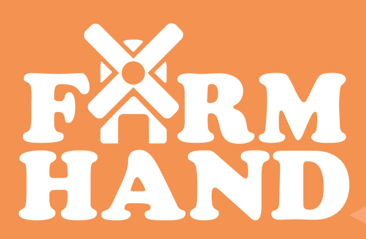
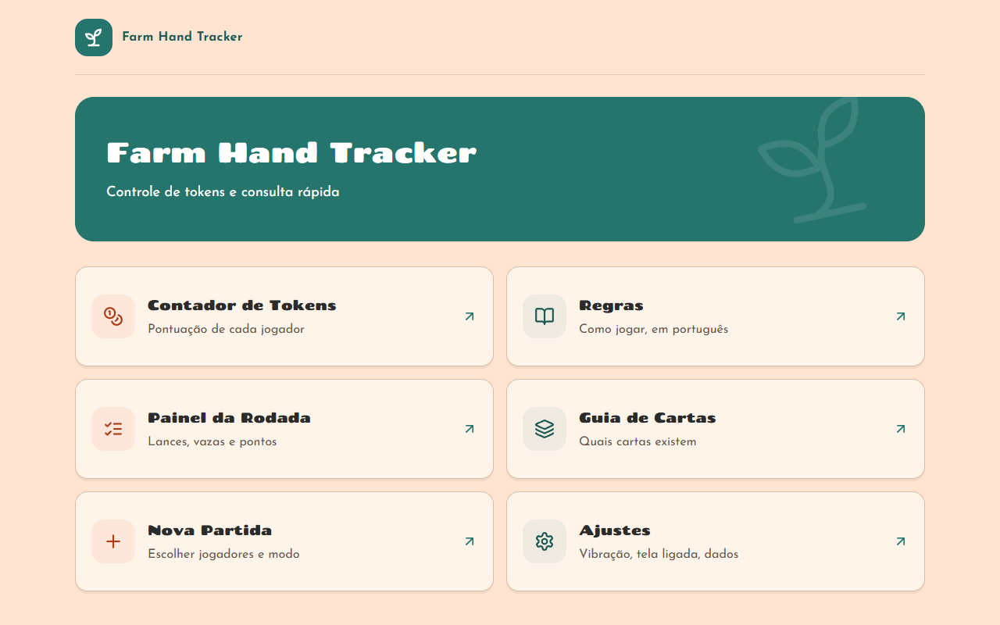
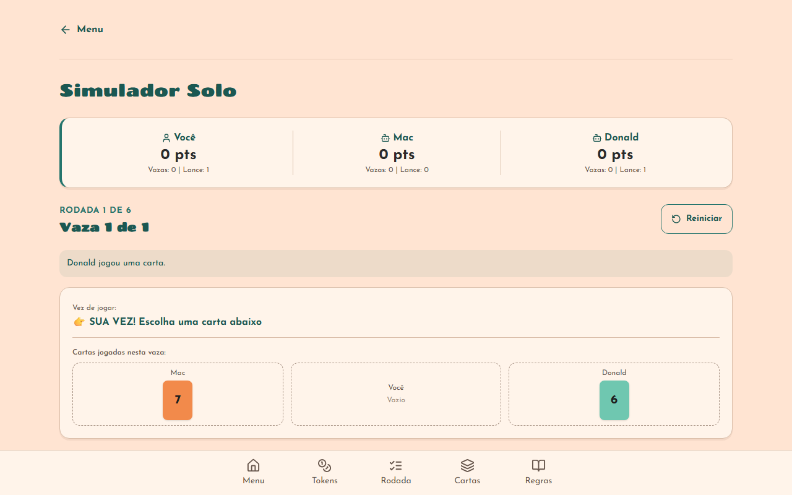
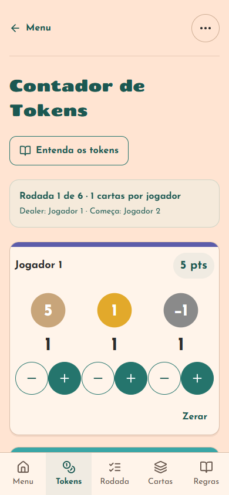
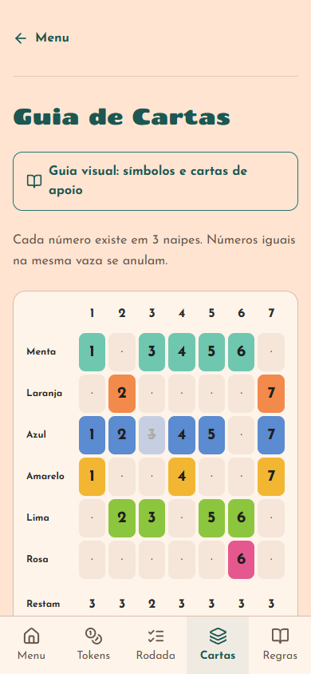
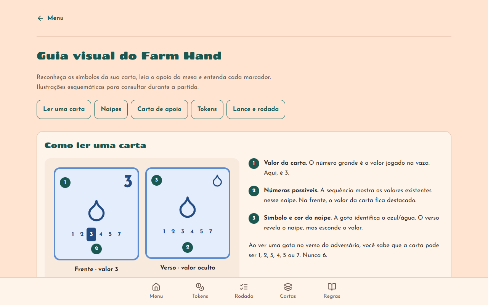
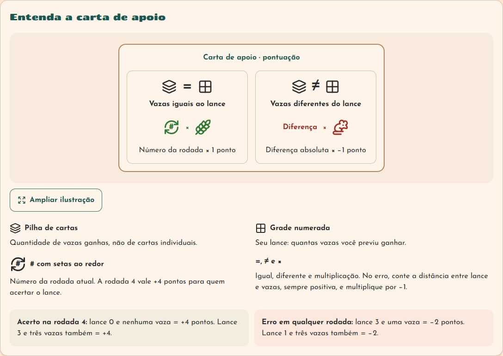

<p align="center">
  
</p>

# Farm Hand Tracker

Aplicativo em português para acompanhar partidas físicas de **Farm Hand**. Contador de tokens, painel de rodadas, consulta de regras, controle das 21 cartas e guia ilustrado dos símbolos. Mobile-first, instalável e com dados salvos no navegador.

- **Abrir o app:** https://farm-hand-tool.vercel.app
- Repositório: https://github.com/maikonfcosta/farm-hand-tool
- Acompanhamento: [board Trello](https://trello.com/b/h70U7s7k/farm-hand-tracker)
- Especificação: [docs/specs/webapp.md](docs/specs/webapp.md)
- Decisões: [DECISIONS.md](DECISIONS.md)
- Validação por fase: [docs/qa/progresso.md](docs/qa/progresso.md)
- Validação do guia visual: [docs/qa/guia-visual.md](docs/qa/guia-visual.md)

## Conheça o aplicativo

O menu reúne os atalhos para preparar a partida, contar pontos, acompanhar
rodadas e consultar regras.



### Simulador Solo Interativo

Jogue partidas completas do modo solitário oficial diretamente no navegador contra os oponentes virtuais **Mac** (à sua esquerda) e **Donald** (à sua direita).

- **Regras oficiais completas**: lances fixos dos bots, rodízio de liderança de vaza (R1/R4: Mac, R2/R5: Donald, R3/R6: Você) e obrigação de seguir o naipe.
- **Inteligência dos bots**: jogam a carta do topo ou a do topo do naipe pedido.
- **Anulação de empates**: cartas com valores numéricos idênticos na mesma vaza se anulam mutuamente.
- **Pontuação e meta**: cálculo automático de acertos e penalidades ao fim de cada rodada com objetivo de vencer os dois bots e atingir 21 pontos.



### Tokens e cartas no celular

Conte sacos, espigas e ratos por jogador, acompanhe a soma e marque as cartas
que já apareceram. As capturas usam uma partida demonstrativa e os ícones
numéricos disponíveis no clone público.

<p>
  
  
</p>

### Guia visual de símbolos

Descubra o que a frente e o verso revelam, reconheça os seis naipes e consulte
seus números possíveis. As ilustrações podem ser ampliadas. Abra pelo atalho
**Guia visual: símbolos e cartas de apoio**, nas telas Cartas e Regras.



### Carta de apoio explicada

Pictogramas acompanhados de texto mostram como comparar lance e vazas e calcular
a pontuação. O guia também explica os tokens +5, +1 e −1, com soma ilustrada,
e a posição dos marcadores nas cartas de lance e rodada.



Capturas da versão local em 24/10/2026. As novidades locais podem ainda não estar
disponíveis no endereço de produção.

## Rodar localmente

Requer Node.js 22.12+ e npm. Validado com Node 24.5.0 no Windows. Execute na pasta do projeto:

```sh
npm ci
npm run dev
```

Abra http://localhost:3000. O desenvolvimento não registra o service worker. Para testar offline, use o build de produção:

```sh
npm run build
npm start
```

Abra http://127.0.0.1:4173. O guia fica em http://127.0.0.1:4173/guia/. `npm start` serve somente o export em `out/`. As fontes são baixadas durante o build e servidas localmente depois.

## Como usar

1. No menu, escolha **Nova Partida** ou **Contador de Tokens**.
2. Escolha de 2 a 5 humanos ou **Solitário**. Nomes vazios recebem o padrão; nomes repetidos são recusados.
3. Com dois humanos, Mac entra automaticamente. No solo, você joga com Mac e Donald.
4. No contador, use − e + abaixo de cada imagem. O cabeçalho de cada jogador mostra a soma: `5 × sacos + espigas − ratos`.
5. No painel da rodada, informe lances e vazas. Os lances de Mac e Donald são fixos. Confira a prévia e confirme a aplicação dos pontos.
6. A rodada avança automaticamente; as marcações de cartas são limpas. **Desfazer última rodada** restaura lances, vazas e tokens anteriores à aplicação.
7. Após seis rodadas, confira o ranking. Empate no topo permite repetir a rodada 6, somando os novos pontos.

Os contadores manuais e os pontos aplicados por rodada somam entre si. Não aplique automaticamente uma rodada já contabilizada à mão. Zerar tokens não apaga o histórico de rodadas.

## Telas

| Rota          | Uso                                                |
| ------------- | -------------------------------------------------- |
| `/`           | Menu com sete atalhos e continuação da partida     |
| `/jogo/novo/` | Modo, jogadores, nomes e primeiro dealer           |
| `/jogo/`      | Três contadores por jogador e ranking              |
| `/rodada/`    | Dealer, início, cartas, lances, vazas e histórico  |
| `/cartas/`    | Grade dos seis naipes e marcações de cartas vistas |
| `/regras/`    | Resumo e regras com busca sem diferenciar acentos  |
| `/guia/`      | Guia ilustrado de naipes, cartas de apoio e tokens |
| `/ajustes/`   | Vibração, tela ligada, limpeza de dados e créditos |
| `/simulador/` | Simulador solo interativo contra Mac e Donald      |
| `/fim/`       | Resultado, metas do solo e desempate               |

Contador, rodada e resultado exigem uma partida. Sem partida, redirecionam para a configuração.

O guia visual fica disponível sem partida, com atalhos em Cartas, Regras e no
contador. Inclui diagramas ampliáveis da frente/verso e da carta de apoio,
legenda dos seis naipes, valores dos tokens, exemplo de soma e posição dos
marcadores de lance e rodada. As ilustrações são esquemáticas e próprias; não
publicam o PDF nem as artes originais. O guia também entra no cache offline.

## Dados e privacidade

Tudo fica no `localStorage`, chave `farmhand-tracker:v1`. Não há backend, login, analytics ou sincronização. A partida pertence ao navegador e à origem utilizada: localhost e produção têm dados diferentes. Limpar dados do navegador ou usar **Apagar todos os dados** remove a partida.

Somente a partida atual é guardada; não existe histórico entre partidas. Os contadores vão de 0 a 99. Pontuação negativa é permitida.

## Instalar e usar offline

Em produção, carregue o aplicativo com conexão e aguarde a instalação do service worker. No Chrome/Edge, use a opção de instalar aplicativo; no Safari iOS, **Compartilhar → Adicionar à Tela de Início**.

Depois do cache inicial, rotas, JavaScript, fontes, estilos e ícones ficam disponíveis offline. Navegações usam rede primeiro, com fallback ao cache; recursos estáticos usam cache primeiro. Não é necessário manter o servidor local ligado para a versão hospedada já armazenada.

Vibração e Wake Lock dependem do navegador. Os controles aparecem apenas quando suportados. O navegador pode recusar manter a tela ligada por bateria, permissão ou falta de contexto seguro. A solicitação é refeita ao retornar à aba.

## Qualidade e testes

```sh
npx playwright install chromium
npm run lint
npm run typecheck
npm test
npm run build
npm run test:e2e
```

Atalho completo, obrigatório antes de commit/push:

```sh
npm run qa-ci-local
```

Para fases iniciais ou alterações limitadas, é possível selecionar checks:

```sh
npm run qa-ci-local -- lint typecheck test build
```

- Vitest valida funções puras e ações do store; cobertura mínima de 90% em `src/domain`.
- Playwright usa Chromium em 390×844 e 1280×800, servido de `out/`.
- Teste offline usa o export de produção e desliga a rede do contexto.
- Traces de falhas ficam em `test-results/`; relatório HTML em `playwright-report/`.
- `npm run format` aplica Prettier. `npm audit` verifica a árvore instalada.

Não rode a suíte E2E durante outro build ou instalação. Ela deve usar um export completo e estável.

## Arquitetura e pastas

```text
src/app/          Rotas e layout Next.js
src/components/  Componentes de interação e apresentação
src/content/     Textos pt-BR e regras
src/domain/      Funções puras; sem React ou armazenamento
src/store/       Zustand, persistência e hidratação
src/hooks/       Wake Lock, vibração e hidratação
public/          Manifesto, service worker, ícones e tokens locais
scripts/         Ícones, pré-cache, servidor estático e QA
tests/unit/      Cálculos e transições de estado
tests/e2e/       Fluxos de usuário no navegador
docs/specs/      Especificação fornecida
docs/reference/  Manual local, ignorado pelo Git
docs/qa/         Plano, evidências e resultados
docs/images/     Logo e capturas usadas neste README
```

Next.js 15, React 19, TypeScript estrito, Tailwind CSS 4, Zustand 5 e Lucide. Export estático com `trailingSlash` e imagens sem otimização de servidor. Hidratação explícita evita divergência entre HTML estático e dados locais.

## Artes e manual

O repositório é público. Conforme a especificação, **não versionamos o PDF nem as artes dos tokens**. Os originais fornecidos foram organizados localmente:

```text
docs/reference/farm-hand-rules-en.pdf
public/assets/tokens/saco-5.png
public/assets/tokens/espiga-1.png
public/assets/tokens/rato-menos-1.png
```

`TokenImage` tenta o PNG e, se ausente, mostra o SVG circular com 5, 1 ou −1. O clone público e o deploy funcionam com esse fallback. `.gitignore` e `.vercelignore` impedem a publicação dos originais. Não retire essas exclusões sem rever a autorização de uso das artes.

A logo no início deste README foi extraída da capa do manual fornecido, a pedido
do mantenedor, para identificar o jogo. Farm Hand e sua logo pertencem à Grail
Games. Essa inclusão não altera as exclusões do PDF e das artes dos tokens.
As capturas em `docs/images/` mostram o aplicativo com dados demonstrativos;
os diagramas do guia são próprios e os ícones são da biblioteca Lucide.

## Deploy na Vercel

Build: `npm run build`. Diretório de saída: `out`. Não há variáveis de ambiente ou banco de dados.

Produção: https://farm-hand-tool.vercel.app. Projeto `farm-hand-tool`, conectado a este repositório; novos pushes na `main` acionam o deploy da Vercel. O deploy inicial foi realizado pela CLI autenticada, pois o MCP da Vercel não estava disponível na sessão.

Pela interface da Vercel, importe este repositório e selecione essas opções. Pela CLI autenticada:

```sh
vercel --prod
```

Confira o projeto e o escopo da conta antes de publicar. A configuração deste repositório não exige recursos de servidor.

Após publicar, valide o endereço real:

```sh
node scripts/smoke-deploy.mjs https://farm-hand-tool.vercel.app
```

Esse smoke confere todas as rotas, manifesto, contadores, persistência, fallback SVG e offline. Ele cria dados sintéticos apenas no contexto isolado do navegador de teste.

Para qualquer hospedagem estática, publique todo o conteúdo de `out/`, mantendo as pastas das rotas e MIME types de JavaScript, CSS, fontes e manifesto. Use HTTPS para instalação PWA e APIs do dispositivo. A porta 4173 é apenas para preview local.

## Fluxo Git e Trello

Trabalho autorizado diretamente na `main`. Para cada card: implementar, validar com `qa-ci-local`, fazer commit em inglês com data/hora GMT-3, push na `main` e mover o card para **Done**, registrando o commit. Board simples: **Observações**, **To do**, **Doing**, **Done**. Links de publicação e notas gerais ficam em Observações.

## Créditos e limites

Farm Hand: design de Craig Somerton, arte de Samuel Bouvant, © 2025 Grail Games. Utilitário não oficial, de uso pessoal, sem vínculo com a editora. Não simula cartas nem jogadas. Não reproduz o PDF do manual.
